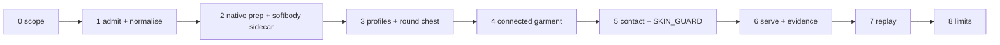

# Garment character route

Route ID: `garment-character`. An explicit agent route, not a harness `--profile`. It composes
**after** native Blender / admitted-asset preparation and **after** `softbody-character`
(`softbody-character-route.md`, `softbody-runtime.md`). It adds a connected garment, an in-place
outfit change, a round chest field and the **outer-layer guarantee** (the skin is never in front of
the cloth). It does not create anatomy, a rig or a likeness.

Every number below is traceable to the delivered job `~/.img2/jobs/nami-sketchfab-8e496e5a`
(called JOB; the byte-identical runtime is `runtime/garment-character/`). Where a value could not be
traced it says `unverified`. `H` = figure height = **1.75 m**: the GLB POSITION accessor bounds of
`native/export/character.glb` are y 0 … 1.7499999 m (x ±0.480, z −0.169 … 0.167), which equals
`displayHeight` in `native/preparation-evidence.json` and ATTRIBUTION.txt. `preparation.json` itself
carries no bounds, so H was read from the GLB. Tags: `behaviour` = a rule/ratio that should carry over;
`single-subject` = measured on this one mesh, a starting value to re-derive (see
`reference/garment-parameters.json` `subjectLiterals`).



## 0. Honest scope

INPUTS: reference images, an admitted licensed asset, the user's request.
STEPS: decide what each can establish before any work.

- References alone cannot establish exact depth, back detail, hand-painted texture or likeness.
  JOB's own log (`reference-analysis.json` `rejectedLocalModelGaps`) records that a from-scratch
  procedural model failed on facial construction, hair and clothing detail even though topology and
  export checks passed.
- The delivered model is **not** generated from images. Its mesh and hand-painted atlas are the
  admitted licensed Sketchfab asset *Nami one piece 3d model* by fatymazali, CC BY 4.0
  (`ATTRIBUTION.txt`; `source-assets.json` sha256 `fbf1926d…c62e47d` for `NAMIjoin.zip`, base colour
  atlas `6ff61074…179148f` 2048×1024). A second asset (dinakarim, CC BY 4.0, sha256 `b0495c92…365dea6`)
  was reference-only: `included_in_derivative: false`, no geometry or pixels transferred.
- CC BY needs attribution, licence link and change notice; it does **not** grant franchise rights
  (`ATTRIBUTION.txt`: "One Piece/Nami franchise rights are not established"). No endorsement is implied.
- **Guaranteed** (checkable in this plugin): the stage order; the runtime files byte-identical to the delivered
  ones (`runtime/garment-character/provenance.json`, `tests/test_garment_character_provenance.py`); the 47 node
  tests; the parameter table with each value's class; the acceptance items `A1`–`A13` and a gate
  (`reference/garment-acceptance.md`, `tools/gate_garment.py`) that judges recorded evidence; and the independent
  probe `tools/skin_probes.js`.
- **Not guaranteed:** that reference images produce this model, atlas, face, hair or outfit; a likeness of any
  character; that the `single-subject` numbers transfer to another mesh without being re-derived; results on
  other browsers, GPUs or a physical phone (JOB's runs are headless Chromium and touch emulation); general
  cloth physics; that the outfit-change fall stays outside the skin (`A10`).
- The model, the hand-painted atlas, the hair and the facial geometry belong to the licensed asset's author.
  The orange-white colorway was inspired by the second, reference-only asset, which supplies no pixels or
  geometry (`ATTRIBUTION.txt`); the re-hue itself is code (`recolorPixels`). A replay on a new character needs
  its own admitted source with recorded rights; without one, stop and say so.

OUTPUT ARTIFACTS: a written scope statement in the delivery manifest; `source-assets.json`.
PARAMETERS: none.
GATE: rights recorded with hashes before any edit; attribution and changes in the shipped
`ATTRIBUTION.txt`; no claim of likeness or "from images".

## 1. Source admission and normalisation

INPUTS: the user's official local download (zip), the user's explicit adaptation approval.
STEPS:
1. JOB's `tools/inspect_sources.py` (a JOB file, not shipped in PLUGIN; run with Blender's Python): copies
   originals into `source/`, hashes them, inspects, never executes asset scripts; writes
   `evidence/source-intake.json`. Its archive and reference paths are hard-coded to this job: edit the two
   paths for a new asset (single-subject).
2. Record `source-assets.json` (id, role `base-mesh`/`reference-only`, creator, licence + url, local path,
   sha256, map colour space, `permissions`, `included_in_derivative`).
3. JOB's `native/prepare_character.py` (a JOB file, not shipped in PLUGIN) is the **worked example** of
   normalising and preparing a copy (Blender 4.5.15 LTS: `blender --background --python
   native/prepare_character.py`). Re-derive for a new asset:

| Constant (prepare_character.py) | JOB value | Fraction of H | Class | Re-derive from a new asset |
|---|---|---|---|---|
| `SCALE` | 0.5848801238530057 | n/a | single-subject | `1.75 / (source extent along the vertical axis)`: 1.75 / 0.5848801 = 2.992 source units. The script hard-codes it; this derivation is `[INFERENCE]` (not recomputed from the source bounds here) |
| `XCENTER` | −1.407831609249115 | n/a | single-subject | the lateral offset subtracted before scaling so the figure sits at x = 0 (`[INFERENCE]`: source bounding-box centre; verify against the new bounds) |
| `FLOOR` | 0.27501729130744934 | n/a | single-subject | the vertical offset subtracted before scaling so the feet sit at y = 0 (`[INFERENCE]`: source minimum; verify). Check the result: GLB POSITION y-min ≈ 0, y-max = 1.75 |
| display height | 1.75 m | 1 | behaviour (choose per project) | the height H you normalise to; all `single-subject` metre values below scale by it |
| `weights()` thresholds `abs(x)>.21 and z>.94` (arms stay on Spine); head ramp `(z−1.51)/.055`; spine ramp `(z−1.13)/.095` | as written | 0.12 / 0.54 / 0.86 / 0.65 H | single-subject | landmarks (shoulder width, neck, waist) of the new rig, as heights above the floor |
| `REGIONS` ellipsoid priors (chest c=(±.065,1.39,.095) r=(.09,.115,.095); hips c=(±.085,.94,−.060) r=(.09,.105,.075); waist c=(±.078,1.19,0) r=(.055,.095,.09); cheek c=(±.043,1.575,.047) r=(.023,.021,.030); abdomen c=(0,1.21,.065) r=(.085,.13,.06)) | as written | e.g. chest height 0.794 H | single-subject | "priors calibrated to this source's measured bounding box, not anatomical measurements" (script comment): place by viewing the new mesh, keep each region non-empty (the script raises on an empty region) |
| control bones Root z 0→0.08, Pelvis 1.0→1.14, Spine 1.14→1.50, Head 1.55→1.73 | as written | 0.571 / 0.651 / 0.857 / 0.886 / 0.989 H (the heads and tails 1.0, 1.14, 1.50, 1.55, 1.73 over 1.75) | single-subject | bone positions from the new mesh; only four control bones, no limbs |
| refinement: SIMPLE subdivision level 2 on body, top, jeans, `uv_smooth NONE`, max source-surface deviation gate 2e-6 m | levels 2; measured 1.7e-7…3.3e-7 m | n/a | behaviour | needed so contact, picking and the garment field have vertices to move; keep the deviation gate |
| skin-weight prune `> 1e-4` | 1e-4 | n/a | behaviour | matches the Blender 4.5 glTF exporter; avoids export drift |

   Source vertex counts → refined (preparation-evidence.json): jeans 1079→21322, top 195→3351,
   body 1939→37771; 23 meshes, 96098 vertices, 178840 triangles. Mesh names are remapped
   (`body`→`Body`, `top`→`BikiniTop`, `jeans`→`Jeans`, `NurbsPath.029`→`Hair`).
OUTPUT ARTIFACTS: `source/` copies, `source-assets.json`, `native/character.blend`, `native/regions.json`,
`native/preparation-evidence.json` (frozen geometry hashes, `sourceUnchanged`, normalisation, refinement).
PARAMETERS: table above.
GATE: `sourceUnchanged: true`; frozen position hashes identical before/after rig and masks
(`geometryUnchangedByRig`); refinement deviation ≤ 2e-6 m; no degenerate triangle (area < 1e-16 raises).

## 2. Native preparation

INPUTS: `native/character.blend`, `native/regions.json`.
STEPS:
1. Skeleton: the four control bones and the small `MotionProbe` clip (180 frames, 60 fps, Root ±8 mm /
   ±12 mm, Spine ±0.008 rad). Scope is stated: no limb, face or finger rig (`rig_scope`).
2. Masks: nine soft groups on Body (`chest-left/right`, `hips-left/right`, `waist-left/right`, `cheek-left/right`,
   `abdomen`), chest on BikiniTop, hips on Jeans (`native/regions.json`; each a `soft_*` vertex group, `bone`
   Spine/Pelvis/Head). Supports (vertices, `preparation.json`): chest 1234, hips 279, waist 462, cheek 317,
   abdomen 967 on Body; chest 1249 on BikiniTop; hips 657/651 on Jeans.
3. Sidecar: `tools/prepare_softbody.py --source … --config … --out …` (byte-identical to the plugin tool)
   → `character.glb`, `softbody.json`, `preparation.json` (`prepared-unreviewed`).
4. Export checks with Blender's Python: JOB's `tools/check_export.py` (a JOB file, not shipped in PLUGIN) writes
   `evidence/export-parity.json` (read-only: hashes before/after, position 1e-6 m, UV 2e-7, normalised skin
   weight 2e-6, soft mask 1e-7).
OUTPUT ARTIFACTS: `native/export/{character.glb,softbody.json,preparation.json}`, `evidence/export-parity.json`.
PARAMETERS: tolerances above (`behaviour`); region priors (`single-subject`, stage 1).
GATE: per-mask vertex count equals POSITION count, values in [0,1], nonzero support; `preparation.json`
`sourceUnchanged`; export parity tolerances met. `prepared-unreviewed` is **not** acceptance of
appearance, animation or performance (`preparation.json` `unverified`).

## 3. Soft-body runtime profiles and the round chest

INPUTS: stage 2 export, `runtime/garment-character/softbody.mjs`, `chest-field.mjs`.
STEPS:
1. `createSoftRig(root, sidecar)` requires exactly the nine `REGION_IDS`
   (`chest-left`, `chest-right`, `hips-left`, `hips-right`, `waist-left`, `waist-right`, `abdomen`,
   `cheek-left`, `cheek-right`) — a missing one throws. Solver: fixed step 1/120 s, ≤ 12 substeps,
   topology guard area ratio ≥ 0.2, edge ratio 0.65…1.45.
2. Profiles (`PROFILES`, key = id prefix):

| Group | frequency Hz | damping ratio | cap m (H) | compression | press depth | Class |
|---|---|---|---|---|---|---|
| chest | 2.4 | 0.11 | 0.008 (0.00457) | 0.16 | — | cap `single-subject`, rest `behaviour` |
| hips | 2.9 | 0.13 | 0.015 (0.00857) | 0.18 | — | same |
| abdomen | 2.8 | 0.30 | 0.014 (0.0080) | 0.06 | 0.008 | same |
| waist | 5 | 0.6 | 0.006 (0.00343) | 0.10 | — | same |
| cheek | 4.5 | 0.80 | 0.0025 (0.00143) | 0 | −0.0012 (lift, not dent) | same |

   Caps "sit near the real mesh's topology-guard range": larger modal caps (chest 30 mm, hips 25 mm)
   only produced flat-topped saturated swings (ATTRIBUTION.txt). Damping 0.22→0.11 (chest) and 0.28→0.13 (hips)
   keeps ~70% amplitude per half-cycle. Contact pads `PADS` chest [0.022, 0.0035] m, hips [0.025, 0.004],
   abdomen [0.025, 0.0005], waist [0.015, 0.0012], cheek [0.014, 0] (radius, depth).
3. Round chest (`chest-field.mjs` `ROUND_CHEST`, applied in `viewer.mjs` before `createSoftRig`):
   authored masks measured lopsided (mean weight 0.77–0.97 toward the top, 0.24–0.38 toward the bottom); a 25 mm
   drag 38 mm from the apex moved tissue 7.9 mm at the top but 2.4 mm at the bottom and the guard halved
   sideways drags (scale 0.51). The field is circular footprint (distance in the frontal plane x/y, +Z = the
   asset's front) × depth term × medial ramp, from the apex (front-most vertex of the *skin* mesh among those
   painted ≥ 0.3, so the garment layered on top does not shift it), divided by the sum where the two breasts' supports overlap; the GLB
   and authored masks stay untouched and still decide garment cup membership.

| ROUND_CHEST | metres | H | Class |
|---|---|---|---|
| plateau (full weight) | 0.05 | 0.0286 | single-subject |
| reach (zero) | 0.105 | 0.0600 | single-subject |
| wallDepth (full to behind apex) | 0.07 | 0.0400 | single-subject |
| wallFade | 0.05 | 0.0286 | single-subject |
| midline (zero) | 0.006 | 0.0034 | single-subject |
| midlineFade | 0.05 | 0.0286 | single-subject; "a ramp narrower than ~45 mm shears the 2–5 mm sternum triangles past the guard" |

OUTPUT ARTIFACTS: `_ROUND` attributes added in the viewer, patched sidecar; `getDiagnostics()` guards.
GATE (acceptance `A11`): at 38 mm from the apex in 8 directions a 25 mm drag moves tissue 7.3–8.0 mm
(inner side 5.8–6.0), guard scale 0.96 (was 0.51), squeeze dents 8.5–10.1 mm (was 2.0–5.3), trusted-mouse
drags from four sides move the breast 8.0 mm in the drag direction (`evidence/connected-interaction.json`
`roundChest`). Unit tests: `chest-field.test.mjs` (4).

## 4. Connected garment

INPUTS: BikiniTop (rest garment mesh) + Body (skin) in the same rig, chest cup membership masks.
STEPS and rules (`garment.mjs`, `garment-field.mjs`, `cloth-contact.mjs`):
1. **ONE connected surface.** Cups, both halter ribbons, the neck loop (y 1.488–1.504 m, behind the neck,
   |x| ≤ 50 mm) and the under band are one mesh: 3351 vertices, **1** connected component
   (cup 999 each, ribbon 262 each, neck loop 299, band 530). The loop joins both ribbons at their top ends,
   the band joins both cups at their lower edge.
2. **Distance ALONG the garment, not air distance.** `buildGraph` welds seam-duplicate vertices
   (shared weld id); `geodesic` is Dijkstra over rest edge lengths; `distanceField` sources are the grabbed
   face's vertices at their straight distance from the grab centre, an unreachable vertex falls back to its
   straight distance. Weight = `falloff(distance, plateau, reach)` = `1 − smoothstep`, zero slope at both
   ends (plateau 0 for a ribbon pull, `PULL_PATCH.plateau` × reach for a cup pull), so neighbours differ by at
   most `falloffSlope = 1.5/(reach−plateau)` × edge length: continuity by construction.
3. **Reach rule.** A ribbon pull reaches `reachFactor` × the surface distance to the *mirror point on the
   other ribbon* (the other ribbon's vertex nearest to the grab centre mirrored in x). Measured: mirror
   distance ≈ 254 mm → reach **393.5 mm**, 2598 of 3351 vertices move, neck loop mean influence 0.74, band 0,
   the other ribbon follows by about a quarter. A cup pull carries the nearest **50%** of all garment
   vertices (`PULL_PATCH.share`, plateau 0.25 of reach): reach 216.1 mm, `reachCount` 1675 of 3351 (the
   evidence also lists 1338 vertices with non-zero weight, after the band fade: `[INFERENCE]`), neck loop 0
   (the 50% rule fades out before it). `delivery-manifest.json` says 178.2 mm for the cup reach; the evidence
   file and `reference-analysis.json` say 216.1, which is used here (178.2 is unverified).
4. **Pinned band only.** `pinFactor = smoothstep(0, pinRange, distance to the under band)`: the only part
   held on the torso; the sewn cup edge is *not* pinned and nothing is pinned at the neck.
5. **Lift/gap rule.** A ribbon pull also stands the garment off the skin by up to `CUP_LIFT.gap`,
   weighted by the same field squared × `pull^0.6` × `liftFade` (ribbon fades out toward the neck,
   `liftFade [0.55, 1]` in strap coordinate) × a lead ramp toward the pull direction. It is added to the
   contact step as the *gap*; cloth is never pushed into the skin.
6. **Part-exclusive grabs.** Same-side ribbon and cup grabs are exclusive; the deformation lives on a
   separate render geometry so the soft-tissue solver, its exact-rest contract and `softbody.mjs`
   (`setTension()` only) are untouched; picking tests the rendered garment.
7. **Outfit change** (`TRANSITION`, 3.8 s; reduced motion: 0.4 s cross-fade): 0–0.4 s release at each
   ribbon's neck end (the last `cutSpan` 12% is hidden, no mid-ribbon gap); 0.4–1.6 s ribbon plus a small cup
   flap (12.2% of cup vertices, ≤ 24.3 mm measured) bend about a hinge 34 mm below the attachment along a
   circular arc, fall with a touchdown at 60% of the window, small bounce, lie on the cup; 1.6–2.7 s a wave
   re-hues green ↔ orange-white (`recolorPixels`, a re-hue of painted fabric, hue 22°, no new geometry);
   2.8–3.5 s ribbons and flaps lift; 3.5–3.8 s ribbon ends reseat. Controls are locked during it.
8. **No removal by pulling.** The garment is a *worn, connected garment, not a removable cup*
   (`garment.mjs` comment at the panel pull limit): ribbon pull is capped (`STRAP.maxPull`), no pull
   detaches it, and the user's undress / nudity steps were declined; the character stays clothed throughout
   (`reference-analysis.json` `connectedGarment.request`). JOB contains no record of a tug-removal build;
   `unverified` beyond that.

| Parameter | metres / value | H | Class |
|---|---|---|---|
| `STRAP.yAttach` / `yTop` | 1.425 / 1.49 | 0.8143 / 0.8514 | single-subject (measured on this BikiniTop) |
| `STRAP.maxAbsX`, `minZ` | 0.085, −0.02 | 0.0486, −0.0114 | single-subject |
| `STRAP.maxPull` | 0.035 | 0.0200 | single-subject |
| `STRAP.grabMin` / `grabMax` | 0.08 / 0.95 (strap coordinate) | n/a | behaviour |
| `STRAP.frequency / dampingRatio / holdFrequency / tension` | 7 Hz / 0.2 / 12 Hz / 0.6 | n/a | behaviour (how they were tuned is `unverified`) |
| `PANEL.maxPull`; frequency; damping | 0.024; 7; 0.7 | 0.0137 | single-subject cap, rest behaviour |
| `PULL_PATCH` share, plateau | 0.5, 0.25 | n/a | behaviour |
| `STRAP_FIELD.reachFactor` | 1.55 | n/a | behaviour |
| `STRAP_FIELD.minReach`, `fallbackReach` | 0.08, 0.2 | 0.0457, 0.1143 | single-subject |
| `STRAP_FIELD.pinRange` | 0.035 | 0.0200 | single-subject |
| `CUP_LIFT.gap` | 0.036 | 0.0206 | single-subject |
| `CUP_LIFT.extent`; `lead` | 0.08; [−0.35, 0.9] | 0.0457 | single-subject / behaviour |
| `FLAP.hinge`, `bend`, `reach` | 0.034, 0.03, 0.075 | 0.0194, 0.0171, 0.0429 | single-subject |
| `FLAP.lift`, `ribbonLift` | 0.0022, 0.0042 | 0.0013, 0.0024 | single-subject |
| `FLAP.cutSpan` | 0.12 | n/a | behaviour |
| `TRANSITION` windows | release 0–0.4, fall 0.4–1.6, morph 1.6–2.7, lift 2.8–3.5, reseat 3.5–3.8 s | n/a | behaviour |
| `FALL_TOUCHDOWN` | 0.6 | n/a | behaviour |

OUTPUT ARTIFACTS: garment render geometry per frame, `getState()`/diagnostics, `evidence/connected-interaction.json`.
GATE: acceptance `A1`–`A7` and `A10` (`reference/garment-acceptance.md`); `node --test` suites
`garment.test.mjs` (15 tests) and `garment-field.test.mjs` (3).

## 5. Contact and the outer-layer guarantee (SKIN_GUARD)

INPUTS: stage 4 garment, the CPU-skinned Body mesh.
STEPS:
1. Contact (`cloth-contact.mjs createClothContact`): each vertex walks its own continuous skin face patch
   (welded vertex fans, ≤ 128 steps, interpolated vertex normals; it never jumps to a nearer but unrelated
   arm or cleavage surface). `project(i, target, out, gap)` keeps the tangential spread and corrects only the
   height along the skin normal to **the vertex's own rest clearance** plus `gap`. Search radius per vertex
   0.14 m for ribbon vertices, 0.055 m otherwise (H 0.08 / 0.0314; single-subject). A vertex's own clearance
   is its *real* rest gap, bounded to `[0.0008, 0.02]` m.
2. Smoothing (`steadyContact`): a vertex's contact correction may differ from its neighbours' mean by at most
   `CONTACT_STEADY.maxDisagreement` = 1 mm (behaviour; H 0.00057), so nearest-skin disagreement across a
   crease cannot open a seam.
3. **Guarantee** (`SKIN_GUARD`, `guardSkin()`, after contact AND smoothing): the garment is the outer layer. No
   vertex closer than `floor` 0.8 mm to the skin; no triangle centre closer than
   `max(centreMin 0.4 mm, floor − sagFactor 4 × the triangle's rest sag)` (rest sag = how far the centre lies
   below its corners' mean height over the skin at rest, i.e. a skin ridge). A violation is lifted **along the
   skin normal only, never toward the skin**, spread to neighbours (`max(own, ½(own + neighbour mean))`),
   over-relaxed ×1.6, up to 6 passes; flap vertices during the fall are guarded too.
4. **Why the cheap pruning is safe.** A vertex left at height `h` by contact and moved by smoothing `s`
   cannot be below `h − s`; only vertices with `h − s < floor + pruneSlack` (0.4 mm, covering height along
   the interpolated normal versus true distance on curved skin) are measured. A triangle centre is measured
   only when its lowest corner is within `centreSlack` (0.3 mm) of its requirement plus 4 × rest sag. Later
   passes re-measure only what the previous pass moved. The pruning only skips what the bound proves is already
   outside; `measure()` is exact. `garment.test.mjs` runs the guard on a steep-bump skin fixture (and the
   recorded scratch copy with `passes: 0` fails it); the evidence records no test that disables only the
   pruning (unverified), so its safety rests on the bound above plus the 93-run independent probe.

| SKIN_GUARD | value | H | Class |
|---|---|---|---|
| floor | 0.0008 m | 0.00046 | behaviour: **must equal the contact minimum rest gap**; rescale with figure size |
| passes / relax / sagFactor | 6 / 1.6 / 4 | n/a | behaviour |
| centreMin / centreSlack / pruneSlack | 0.0004 / 0.0003 / 0.0004 m | 0.00023 / 0.00017 / 0.00023 | behaviour (metre-absolute tolerances) |

5. **The three measured defects that produced it** (found with `tools/skin_probes.js`, an independent
   brute-force probe, not by the guard; the JOB file is named `tools/skin-probes.js`):
   - *Neck loop inside the skin.* Before the guard a ribbon pull put up to **6.1 mm** of the neck loop (78
     samples), up to 3.6 mm of the cups and 3 mm of the ribbon inside the skin (worst direction down-left
     225°; cup pull 2.8 mm). The distance field now carries loop and ribbons into the neck/shoulder where a
     straight displacement sinks into skin. Cause per `evidence/connected-interaction.json`: `[INFERENCE,
     not isolated by a switch-off experiment]`.
   - *1 mm smoothing bound.* Contact raised each vertex alone, then the 1 mm neighbour-disagreement bound
     (added to stop seams opening) left the correction short by up to 6 mm. Rule: **never smooth a contact
     correction without a final one-sided guard.**
   - *Contact clearance clamp.* A thin clamp snapped barely-moved cup-bottom vertices **9 mm** toward the
     skin while the unmoved neighbour stayed behind, tearing the cloth from the band. Fix: keep each vertex's
     real rest gap (now bounded to `[0.8 mm, 20 mm]`). The 14.4× ribbon|cup and 7.4× cup|band junction
     stretches belong to the build *before the connected field* (`connectedChain.before`); the evidence names the
     clamp as one of the repairs, not as the sole cause.
6. **Guard convergence** (`getState().skinGuard`, violations per pass): typical `[296, 15, 3, 1, 0]` (2–5
   passes); the real viewer smoke shows `[289, 17, …]`. In rare frames one triangle-centre sample stays just
   under its 0.4 mm requirement after 6 passes, e.g. `[289, 17, 2, 1, 1, 1]`, while the independent probe still
   finds nothing inside the skin. So `violations[-1] > 0` is **reported, not hidden**. The JOB matrices list
   unconverged frames separately (`summary.guardUnconverged`, empty in `skin-guard-other.json`;
   `maxGuardLastViolations` 0 in `skin-guard-desktop.json`); `gate_garment.py` does not read them.

OUTPUT ARTIFACTS: `evidence/skin-guard-desktop.json`, `skin-guard-other.json`, `proof-skin-ribbon225-front-pair.png`.
GATE: acceptance `A8`: 0 inside samples over 93 runs at the pull limit, probe threshold 0.3 mm inside
(nearest CPU-skinned Body triangle, outward normal), plus counter-example: the same guard tests with `passes: 0`
in a scratch copy fail (cloth 5.32 mm and 0.46 mm under the skin).

## 6. Serving and evidence hygiene

INPUTS: the viewer files, the probe.
STEPS and cases:
1. **No-store server.** `serve.py` sends `Cache-Control: no-store, max-age=0` ("so a rebuilt viewer is never
   served stale"; default port 18773, loopback). Case: the user was shown a stale build (reported in the
   delivery session; JOB records the repair only as `serve.py` and the stamp). Do not use
   `python3 -m http.server` for review (JOB's own `ATTRIBUTION.txt` RUN/EDIT text still says to; its
   `package.json` `start` script uses `serve.py`).
2. **Visible build stamp.** `viewer.mjs` sets `window.namiStudio.build = 'guard-1'`; `index.html` footer shows
   `build guard-1` (`#build-stamp`). Check the stamp before reading any result. `evidence/skin-guard-*.json`
   carry `chain-1 (identical code to guard-1; only the footer stamp was renamed afterwards)`.
3. **Real trusted pointer input, in the default view.** The default view is `quarter` (camera
   [2.25, 1.03, 3.2]); the ribbon is ~5 mm wide, so `viewer.mjs strapNear` searches a small ring (mouse
   4, 8 px; touch 5, 10, 15 px) when a press lands beside it but never steals a press that hits a soft region.
   Case: the ribbon was un-grabbable in the 3/4 default view (reported in the session; that the ring search is the
   fix is `[INFERENCE]`). Prove grabs with CDP `Input.dispatchMouseEvent` / `dispatchTouchEvent` (`trusted:true`),
   not API calls, in the *default* view as well as the torso view. Touch is emulation (390×844 @2×).
4. **30 s per-call browser cap.** Long probe runs must be chunked: each browser tool call is capped at about
   30 s in the harness used for delivery (reported in the session; not recorded in a JOB file). JOB's matrix
   ran page-paused with `namiStudio.step(1/60)`, `renderer.render` stubbed (GL draw only) and
   `requestAnimationFrame` throttled to 1/s; garment apply, guard, solver and probe were unchanged.
   The 2 screenshots used the real render.
5. **Never self-certify with the guard's own measure.** In the outfit-change fall the guard's own measure
   converged to 0 while the independent probe still flagged ribbon samples inside the skin (up to 13 mm at
   1.0 s while the ribbon sweeps over the cup edge, a few up to ~33 mm at the hanging end), although from four
   cameras at fold = 1 the ribbon lies on top of the cup. A result is a pass only when the probe — its own
   skinned-triangle nearest search, not `getState().skinGuard` — reports it.
OUTPUT ARTIFACTS: `serve.py`, stamp, probe JSON.
GATE: stamp in evidence matches the file served; inputs trusted; probe independent.

## 7. Replay on a new character

All paths are relative to `~/.img2/plugins/character` (PLUGIN).
```bash
P="$HOME/.img2/plugins/character"; J=/absolute/path/to/new-job
# 1 admit + normalise: record rights/hashes, adapt prepare_character.py (stage 1 table)
# 2 prepare: Blender Python (JOB ran Blender 4.5.15 LTS; whether the pip `bpy` venv below matches is unverified)
B="$HOME/.img2/runtime/character-bpy/bin/python"
"$B" "$P/tools/prepare_softbody.py" --source "$J/native/character.blend" --config "$J/native/regions.json" --out "$J/native/export"
# 3 runtime: copy byte-identical files, then re-derive subject literals
cp -R "$P/runtime/garment-character/." "$J/"      # softbody.mjs garment.mjs garment-field.mjs cloth-contact.mjs chest-field.mjs picking.mjs viewer.mjs index.html styles.css serve.py (+ LICENSE-runtime, provenance.json)
#    re-derive reference/garment-parameters.json "subjectLiterals" (STRAP, FLAP, CUP_LIFT, ROUND_CHEST, PROFILES caps, mesh/bone names in viewer.mjs)
# 4 unit tests of the byte-identical runtime (Node >= 20; `three` 0.186.1 in PLUGIN/node_modules; the viewer also needs three@0.186.1 in $J/node_modules for its importmap, JOB's package.json declares it)
( cd "$P" && node --test tests/garment-character/*.test.mjs )      # 47 tests: chest-field 4, garment-field 3, garment 15, softbody 25
# 5 serve with no-store and open the viewer; check the build stamp
python3 "$J/serve.py" 18773 &      # http://127.0.0.1:18773/  -> footer "build guard-1"
# 6 probe matrix in the browser with $P/tools/skin_probes.js (protocol: reference/garment-acceptance.md)
# 7 gate
python3 "$P/tools/gate_garment.py" --matrix "$J/evidence/skin-guard-desktop.json" --matrix "$J/evidence/skin-guard-other.json" --matrix "$J/evidence/connected-interaction.json" \
  --sampling-declared "hold 36 frames/12, release, rebound 60/12, settle 300 + 1 sample = 9 per case"
# Run against JOB's own recorded files for this document: G1 pass (93 cases, deepest 0 mm), G2 pass, G3 pass
# (32 cases record per-phase counts, 61 only a total `samples` >= 9, covered by the declaration), G4 pass (84 pulls:
# ribbon >= 0.7 x 35 mm = 24.5 mm, cup >= 0.7 x 24 mm = 16.8 mm), G5 pass (16 release cases); exit 0.
# Without --sampling-declared G3 is `unmeasured` and the exit is 2, by design. A subset of the matrix is not a pass.
```
`viewer.mjs` hard-codes the mesh names `Body` / `BikiniTop` and the paths `native/export/character.glb` and
`native/export/softbody.json`, and `garment.mjs` hard-codes `STRAP` / `FLAP` coordinates; a new character
changes these (single-subject). `gate_garment.py` takes `--matrix FILE` (repeatable), `--json`,
`--sampling-declared TEXT` (accepts a total `samples >= 9` per case and says "declared, not recorded"),
`--parameters FILE` (default `reference/garment-parameters.json`), `--min-pull-fraction` (default 0.7 of
`STRAP.maxPull` / `PANEL.maxPull`), `--ribbon-limit-mm` / `--cup-limit-mm` (fallbacks when the file has no
limit) and the absolute overrides `--min-ribbon-pull-mm` / `--min-cup-pull-mm`. It exits 0 only when G1–G5 all
pass, 1 on any fail, 2 on unmeasured or unusable input. `tests/test_gate_garment.py` holds its counter-examples.

## 8. Known limits

From `reference-analysis.json` `connectedGarment.limits`, `scopeLimits` and `ATTRIBUTION.txt` KNOWN LIMITS:
- Not general cloth physics and no self-collision. While pulled some triangles flip locally (ribbon pull: 15
  desktop / 41 touch; cup pull: 2 / 11; the sources say "of 3730" but the matrix records `triangles: 6192`, so
  the denominator is unverified) and up to 7 edges of 9540 stretch past 2.5× (1 on desktop; `ATTRIBUTION.txt`
  places it in the neck loop, the evidence does not); no tear or hole is visible in captured frames.
- 8–19% of the skin under the cup is uncovered at a 25 mm ribbon pull (previous build 10–19%), because the cup
  is carried by the whole chain and held at the band. Only the under band is held; the sewn cup edge is not
  pinned. The flap is the free cup corner and moves during the fall by design. The colorway is a re-hue, not a
  new outfit geometry.
- **The outfit-change fall is not covered by the outer-layer guarantee** (stage 6 case 5).
- Behaviour lives in the viewer runtime, not in the GLB: the GLB has rest geometry, masks and the bone clip
  only; pulls, the sequence and the round chest need `viewer.mjs` + `softbody.mjs` + `picking.mjs` +
  `softbody.json`.
- Cost (headless Chromium, software GL, recorded host and viewport only): `garments.apply()` under a held
  pull median 7.9–10.2 ms / p95 13.3–15.3 ms for a ribbon pull (6.3 / 8.5 before the guard); cup pull
  4.4–4.9 / 6.9–8.9 (3.3 / 4.8); fall 4.3 / 8.9 at a heavily loaded moment (load average ~90; 1.9 / 3.0
  before). Other measured run: ribbon-pull apply median 4 / p95 5.6 / max 13.5 ms, softbody update median 8.6 ms.
- Touch is Chromium emulation, not a physical phone. Frame rates do not transfer to other devices.
- Artistic bounded surface response, not FEM, full-body/cloth/hair collision or physical haptics. The
  atlas is a relit artist atlas, not scanned skin; native Blender scattering is not browser scattering.
  Four control bones and one small clip; no humanoid, face or finger rig.
- Franchise rights are not established by the CC BY fan-art licence.
- A 4K surface plan exists in JOB (`docs/4k-surface/`) but is **not** implemented; no 4K maps exist.
